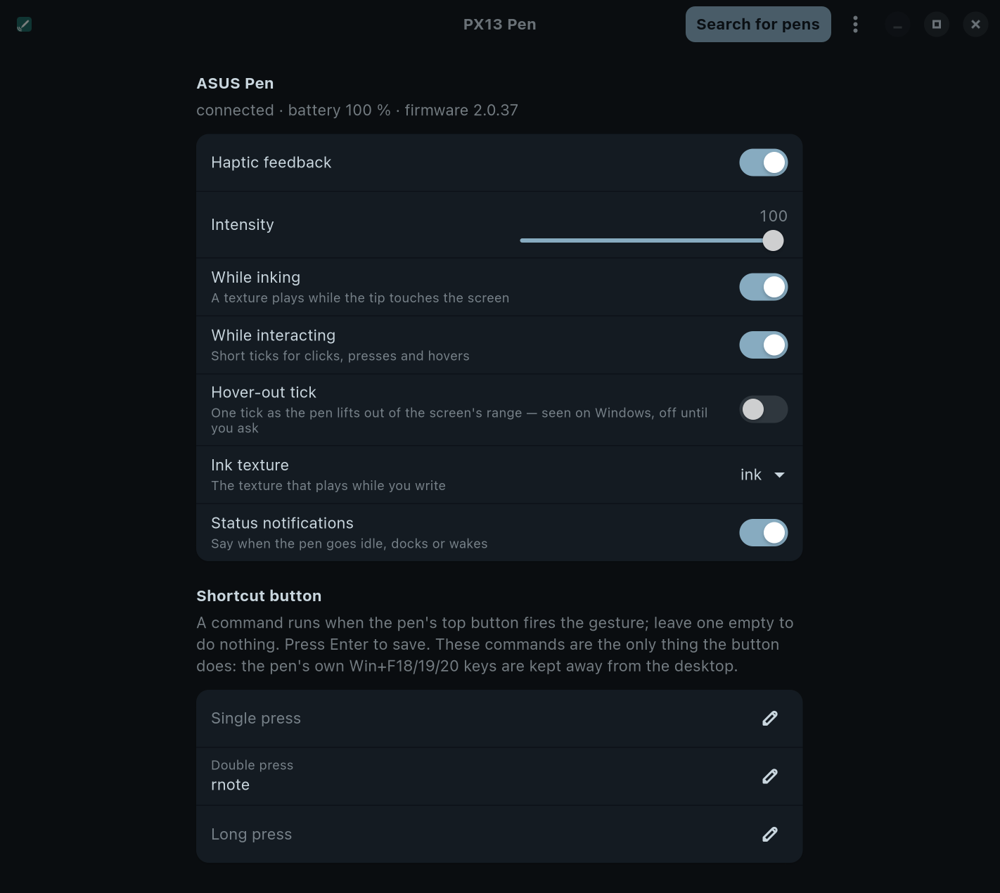

# PX13 SA205H Linux

Everything the **ASUS Pen 3.0 (SA205H)** does on Windows, on Linux, for the
**ASUS ProArt PX13 (HN7306)**: touch-to-pair, haptic feedback you can feel
while you write, the pen's battery, its top button, a tray icon and a
settings window.

Drawing itself (pressure, tilt, eraser, side button) already works on Linux
without this project. This adds the parts that ride Bluetooth.

<p align="center">
  
</p>

## What you get

| | |
|---|---|
| **Touch-to-pair** | Bring the pen to the screen and it pairs in under a second. No Bluetooth menu, no code, no button to hold. |
| **Haptic feedback** | The pen vibrates gently while the tip is on the screen, like writing on paper. Six textures to pick from, adjustable strength. |
| **Battery** | The pen's own battery reading, to the percent, in the tray and the settings window. |
| **Top button** | Single, double and long press each run a command you choose. Double press opens [RNote](https://rnote.flxzt.net/) out of the box. |
| **Tray icon** | Battery, connection, haptics on/off and strength, one click away. Shows up while the pen is in use. |
| **Notifications** | A short note when the pen goes idle, is put on its charger, or is picked up again, with the battery level. Can be switched off. |
| **Settings window** | Every option in one place (screenshot above). |

## Install

Pick the line for your system. The [install guide](docs/install.md) has the
details for each distribution.

- **Any distribution:** download a tarball from the
  [Releases page](https://github.com/gonzalezerik/px13-sa205h-linux/releases),
  then:
  ```sh
  sha256sum -c SHA256SUMS --ignore-missing
  tar xf px13-sa205h-linux-*.tar.gz
  cd px13-sa205h-linux-*/
  sudo ./install.sh
  ```
  Take the **glibc** tarball on current distros (Fedora 42+, Debian 13+,
  Ubuntu 25.04+, Arch, Tumbleweed); it includes the settings window. Take
  **musl** on anything older or unusual; it has everything except the
  settings window. Both come for **x86_64** and **aarch64**.
- **Arch Linux:** build the package from [`contrib/PKGBUILD`](contrib/PKGBUILD)
  with `makepkg -si`.
- **NixOS:** add the flake and turn the module on:
  ```nix
  # flake.nix
  inputs.px13-sa205h-linux.url = "github:gonzalezerik/px13-sa205h-linux";

  # configuration.nix
  imports = [ inputs.px13-sa205h-linux.nixosModules.default ];
  services.px13-sa205h-linux.enable = true;
  ```

Then **sign out and back in**. That's all the setup there is.

## Getting started

1. **Pair:** hold the pen over the screen or touch it. Within a second you
   get a notification saying the pen is paired.
2. **Write:** you should feel a soft texture while the tip touches the
   screen. Turn it up or down in the tray or the settings window.
3. **Try the top button:** double press it and RNote opens.
4. **Put it down:** after a few seconds the pen goes to sleep to save
   battery and you get an "Idle" note. Pick it up and it reconnects on its
   own.

## Settings, explained

Open them from the tray (**Settings…**) or your app launcher (**PX13 Pen**).

| Setting | What it does | Default |
|---|---|---|
| **Haptic feedback** | Main switch for every vibration. | On |
| **Intensity** | How strong the vibrations are, 0–100. | 100 |
| **While inking** | A texture plays while the tip touches the screen. | On |
| **While interacting** | Lets apps play short ticks (clicks, presses). | On |
| **Hover-out tick** | One tick as the pen leaves the screen's range, like Windows does after a hover. | Off |
| **Ink texture** | What writing feels like: *ink*, *pencil*, *marker*, *chisel*, *brush* or *sparkle*. The eraser end always uses the eraser texture. | ink |
| **Status notifications** | The idle / on charger / picked-up notes. | On |
| **Shortcut button: Single press** | Command to run on one press of the top button. Empty does nothing. | empty |
| **Shortcut button: Double press** | Command for a double press. | `rnote` |
| **Shortcut button: Long press** | Command for holding the button. | empty |

A shortcut command is any command you'd type in a terminal, such as
`flatpak run com.github.flxzt.rnote`, `xournalpp`, or
`notify-send "pen button"`. Press Enter in the field to save it. Settings are
kept per user and survive restarts.

**Search for pens** (top of the window) starts a pairing search, for when
touching the screen didn't pair the pen.

## The tray icon

The icon appears while the pen is connected and hides a minute after the pen
goes to sleep. Click it for:

- the pen's name, battery and connection state
- **Haptics** on/off and **Intensity** (Low 25 %, Medium 50 %, High 100 %)
- **Status notifications** on/off
- **Pair a pen…** and **Settings…**

The tray uses the standard StatusNotifierItem protocol, so it needs a panel
that shows those icons:

| Desktop / window manager | What to do |
|---|---|
| KDE Plasma, Cinnamon, Budgie, LXQt | Nothing, it shows up. |
| XFCE | Nothing on current versions (*Status Tray* plugin). |
| GNOME | Install the [AppIndicator and KStatusNotifierItem Support](https://extensions.gnome.org/extension/615/appindicator-support/) extension. Ubuntu ships it on by default. |
| Sway | Nothing, swaybar shows tray icons. |
| Hyprland, niri, river, other Wayland compositors | Use a bar with a tray: Waybar with the `"tray"` module, Noctalia, HyprPanel, ironbar or a quickshell config. |

Tested on niri with Noctalia. The others follow the same standard. If your
panel has no tray at all, everything stays reachable through the settings
window and `px13penctl`.

## Notifications

| You'll see | When |
|---|---|
| **ASUS Pen paired** | The first time a pen pairs. |
| **Pen pairing failed** + what to try | A pairing attempt didn't work, at most once in a row. |
| **ASUS Pen** · *Idle · 84 %* | You put the pen down and it went to sleep. |
| **ASUS Pen** · *Docked · Charging 84 %* | You put it on its charger. |
| **ASUS Pen** · *84 %* | You picked it up again. |

The status notes replace each other instead of piling up, and the **Status
notifications** switch turns them off. Pairing notes always show.

## The pen's buttons

- **Top button** (the end cap): single, double and long press run your
  shortcut commands. It does nothing else, so your desktop never receives
  stray key presses from it.
- **Side button (barrel):** hold it and tap the tip to right-click in most
  apps. Drawing apps such as Krita, Xournal++ and RNote let you assign it
  to something else. A click while only hovering does nothing, as on
  Windows.

## When something's off

| Problem | Try |
|---|---|
| The pen doesn't pair | Hover the pen over the screen for a couple of seconds, then touch. If a pairing just failed, wait a minute: the pen ignores touches briefly after a failed attempt. Still nothing? Hold the top button until the light blinks white, then touch the screen. |
| No tray icon | Your panel may not show tray icons (see the table above), or the pen is asleep. Pick it up. |
| A shortcut command does nothing | Run `journalctl --user -u px13pend -n 20`; a command that fails says why there. |
| No vibration | Check **Haptic feedback** and **While inking** are on, and that the pen is connected (`px13penctl status`). |
| Anything else | `systemctl --user status px13pend` shows whether the background service runs. |

## Supported hardware

This has been built and tested on one combination: the **ASUS ProArt PX13
(HN7306)** with the **ASUS Pen 3.0 (SA205H)**. On other laptops the
background service recognises no supported screen and stays idle. Have
different hardware and want to help? The
[other-hardware guide](docs/wiki/pages/other-hardware.md) walks you through
a few safe, read-only checks and what to send.

## Security note

Windows pairs the pen with a random secret key. Linux can't do that kind of
pairing yet, so it uses the fallback the pen accepts, a fixed code of 0.
Someone recording the radio at the exact moment of pairing could work out
the connection key. To make that useless, this project keeps the pen's
Bluetooth keyboard and mouse away from your desktop: a device posing as your
pen could at most fake a top-button press, which only runs the commands you
set. The details and the kernel change that would close the gap are in
[how the pen connects](docs/how-the-pen-connects.md).

## More

- [Install guide](docs/install.md) for each distribution
- [Settings reference](docs/settings.md) · [tray](docs/tray.md) ·
  [`px13penctl`](docs/px13penctl.md) · [D-Bus API](docs/dbus.md) for scripts and other apps
- [Wiki](docs/wiki/pages/index.md): how the pen works, reverse-engineering notes, open questions
- [Development](docs/development.md): building from source, running the pieces by hand
- [Changelog](CHANGELOG.md)

## Disclaimer

A hobby project, not vendor software. It only sends what the published
specifications and the vendor's own software send, and never writes to
firmware. Even so, software this close to the hardware can make a device
misbehave until it restarts. **Use it at your own risk. There is no warranty
of any kind** (see AGPL §16).

## License

[GNU AGPL-3.0-or-later](LICENSE). Contributions: [CONTRIBUTING.md](CONTRIBUTING.md).
